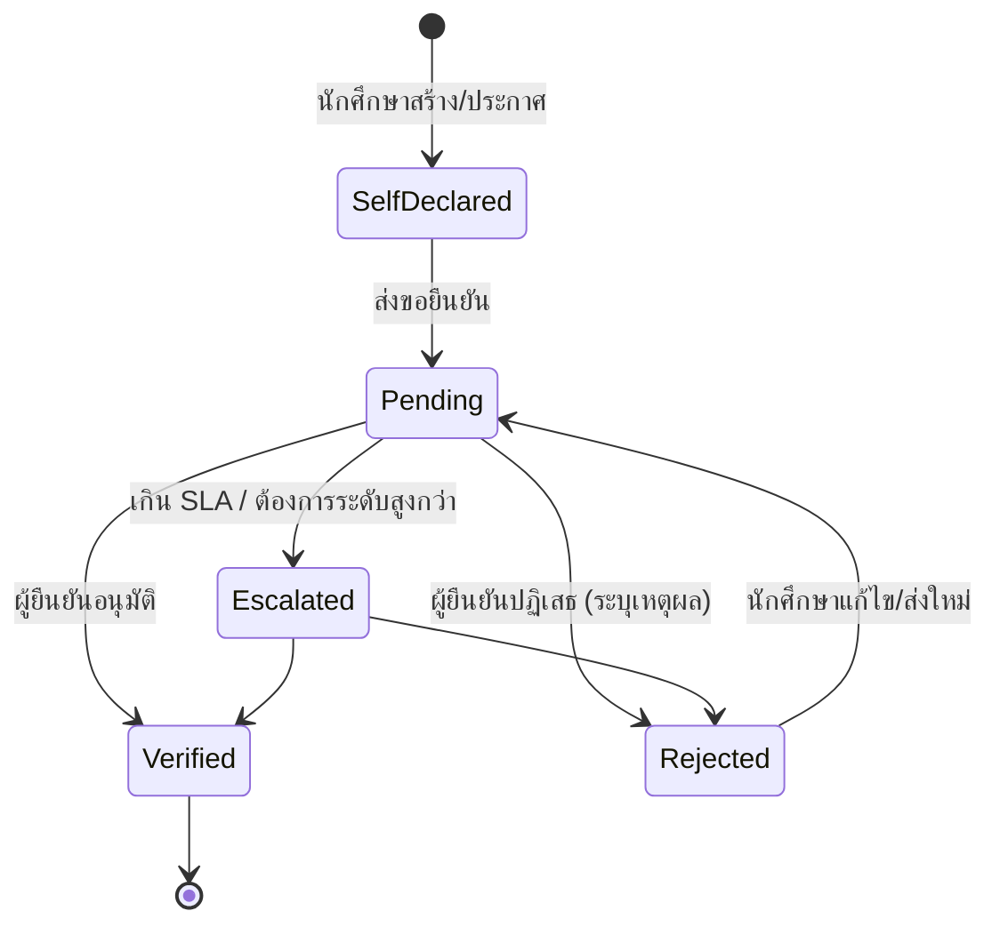
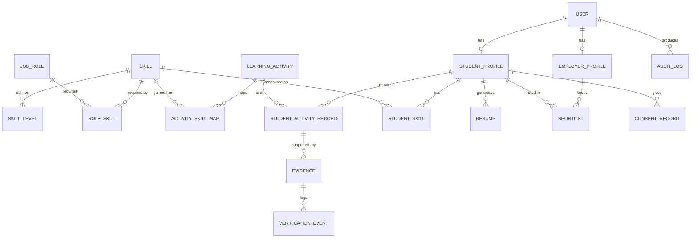
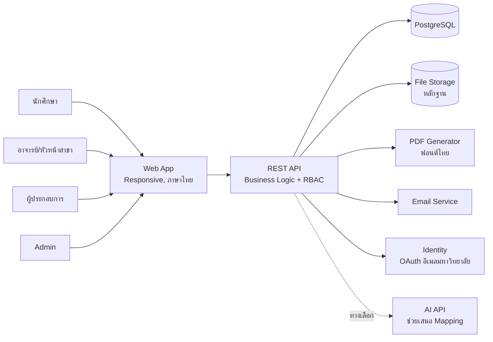

# เอกสารสรุปโครงการ: แพลตฟอร์มวัดทักษะและสรุป Resume สำหรับนักศึกษา IT

> **วัตถุประสงค์ของเอกสารนี้:** เป็นแหล่งข้อมูลกลาง (Source of Truth) ที่รวบรวมแนวคิด เหตุผล ขอบเขต ข้อกำหนดเบื้องต้น ข้อมูลเชิงเทคนิค และข้อจำกัดของโครงการ เพื่อนำไปเขียนเอกสาร **SRS (Software Requirements Specification)** ต่อ
>
> **สถานะ:** ฉบับร่างสำหรับต่อยอด (Draft v0.1) | **วันที่:** 13 พฤศจิกายน 2026
> **หมายเหตุ:** รายการที่ทำเครื่องหมาย `[TBD]` คือสิ่งที่ยังต้องตัดสินใจหรือยืนยัน ตัวเลขงบประมาณ/เกณฑ์ต่าง ๆ เป็น **ข้อเสนอเริ่มต้น** ที่ต้องทบทวนกับทีมและผู้เชี่ยวชาญ
> รหัสข้อกำหนด (FR-xx, NFR-xx, BR-xx) เป็นรหัสชั่วคราว สามารถนำไปจัดเลขใหม่ใน SRS ได้

---

## สารบัญ

0. วิธีใช้เอกสารนี้
1. ภาพรวมโครงการ (Why / What / How)
2. ขอบเขตและข้อกำหนดของโครงการ
3. แนวคิดหลักของระบบ
4. การใช้มาตรฐาน SFIA
5. ผู้มีส่วนได้ส่วนเสียและผู้ใช้งาน (Actors)
6. ข้อกำหนดเชิงหน้าที่ (Functional Requirements)
7. กฎทางธุรกิจ (Business Rules)
8. อัลกอริทึมการคำนวณและตัวอย่าง
9. กระบวนการยืนยันหลักฐาน (Verification Workflow)
10. โมเดลข้อมูล
11. ข้อกำหนดที่ไม่ใช่เชิงหน้าที่ (NFR)
12. สถาปัตยกรรมและเทคโนโลยี
13. แผนการเตรียมข้อมูล (Data Preparation)
14. ข้อจำกัด สมมติฐาน และสิ่งที่ต้องพึ่งพา
15. ทีม งบประมาณ และแผนงาน
16. กรอบงานวิจัยและการประเมินผล
17. ความเสี่ยง
18. ประเด็นที่ยังเปิดอยู่
19. แผนที่เชื่อมไปยังโครงสร้าง SRS
20. อภิธานศัพท์
21. แหล่งอ้างอิง

---

## 0. วิธีใช้เอกสารนี้

| ถ้าต้องการเขียน SRS ส่วน... | ให้ดูหัวข้อ |
|---|---|
| 1. บทนำ (วัตถุประสงค์ ขอบเขต คำนิยาม) | 1, 2, 20 |
| 2. ภาพรวมของผลิตภัณฑ์ (มุมมอง ผู้ใช้ สมมติฐาน ข้อจำกัด) | 3, 4, 5, 14 |
| 3. ข้อกำหนดเฉพาะ: ฟังก์ชัน | 6, 7, 8, 9 |
| 3. ข้อกำหนดเฉพาะ: ข้อมูล | 10 |
| 3. ข้อกำหนดเฉพาะ: ที่ไม่ใช่ฟังก์ชัน | 11 |
| ภาคผนวก (สถาปัตยกรรม แผนงาน ความเสี่ยง) | 12–18 |

---

## 1. ภาพรวมโครงการ (Why / What / How)

### 1.1 ปัญหาที่ต้องการแก้ (Why)

1. **นักศึกษา** ไม่เห็นความเชื่อมโยงชัดเจนระหว่างวิชาที่เรียน กิจกรรมที่ทำ กับ **ตำแหน่งงาน** ที่อยากทำ จึงตัดสินใจเลือกวิชา/อบรมโดยไม่มีข้อมูลรองรับ
2. **Resume ของนักศึกษา** มักบอกแค่ชื่อวิชาและเกรด ไม่สะท้อน "ทักษะที่ทำได้จริง" และไม่มีหลักฐานยืนยัน
3. **ผู้ประกอบการ** ค้นหาผู้สมัครที่มีทักษะตรงกับตำแหน่งได้ยาก เพราะข้อมูลไม่เป็นมาตรฐานและเปรียบเทียบกันไม่ได้
4. **มหาวิทยาลัย/สาขา** ไม่มีข้อมูลเชิงระบบว่าหลักสูตรสร้างทักษะอะไรให้ผู้เรียนมากน้อยเพียงใด และขาดช่องว่างตรงไหน

### 1.2 สิ่งที่ระบบคือ (What)

แพลตฟอร์มเว็บที่ **วัดระดับทักษะ** ของนักศึกษาสาขาเทคโนโลยีสารสนเทศและสาขาที่เกี่ยวข้อง จากรายวิชา กิจกรรม การอบรม และการสอบวัดทักษะ โดยอ้างอิงกรอบมาตรฐาน **SFIA** แล้ว

- แสดงให้นักศึกษาเห็นว่า **ตำแหน่งงานเป้าหมายต้องการทักษะอะไร ระดับใด** และตนเองขาดอะไร พร้อมแนะนำสิ่งที่ควรเรียนหรือทำ
- **สรุปเป็น Resume** ที่อิงทักษะและหลักฐานที่ผ่านการยืนยัน
- ให้ผู้ประกอบการ (ที่ได้รับอนุญาต) **ค้นหานักศึกษาที่มีทักษะตรงกับตำแหน่ง** ได้

### 1.3 วิธีการ (How) แบบสรุป

```
กิจกรรมการเรียนรู้  ──(Mapping)──►  ทักษะ SFIA + ระดับ  ──(Role Profile)──►  ตำแหน่งงาน
(วิชา/อบรม/สอบ/โปรเจกต์)           (เช่น PROG ระดับ 2)                      (เช่น Web Developer)
          │                                  ▲
          └─ หลักฐาน + การยืนยัน ────────────┘
```

1. กำหนดชุดทักษะ (SFIA) และระดับ
2. กำหนด **ตำแหน่งงาน** = ชุดทักษะ + ระดับที่ต้องการ + ความสำคัญ (Must-have / Nice-to-have)
3. Map **รายวิชา/กิจกรรม** → ทักษะ + ระดับสูงสุดที่กิจกรรมนั้นพาไปถึง
4. นักศึกษามีผลการเรียน/หลักฐาน → ผู้มีอำนาจ **ยืนยัน** → ระบบคำนวณระดับทักษะ
5. ระบบเทียบระดับทักษะกับตำแหน่ง → แสดง **% Match, Skill Gap, Roadmap**
6. สร้าง **Resume** และเปิดให้ผู้ประกอบการค้นหา (เมื่อนักศึกษายินยอม)

### 1.3.1 วัตถุประสงค์ของโครงการ

| รหัส | วัตถุประสงค์ |
|---|---|
| OBJ-1 | พัฒนาระบบที่แปลงข้อมูลรายวิชา/กิจกรรมเป็นระดับทักษะตามกรอบ SFIA |
| OBJ-2 | ช่วยนักศึกษาวางเส้นทางการเรียนรู้สู่ตำแหน่งเป้าหมายด้วย Gap Analysis และ Roadmap |
| OBJ-3 | สร้าง Resume อิงทักษะที่ผ่านการยืนยันได้โดยอัตโนมัติ |
| OBJ-4 | ให้ผู้ประกอบการค้นหาผู้มีทักษะตรงกับตำแหน่งได้อย่างโปร่งใสและอธิบายได้ |
| OBJ-5 | ประเมินความตรง ความถูกต้อง และความใช้งานได้ของระบบเชิงวิจัย เพื่อต่อยอดเป็นผลิตภัณฑ์จริง |

---

## 2. ขอบเขตและข้อกำหนดของโครงการ

### 2.1 ข้อมูลที่ผู้เริ่มโครงการระบุไว้ (Input จากผู้ริเริ่มโครงการ)

| หัวข้อ | คำตอบ |
|---|---|
| ขอบเขตองค์กร | ใช้ภายใน **มหาวิทยาลัยเดียว** |
| ข้อมูลรายวิชา | มีรายละเอียดรายวิชา แต่เป็น **เอกสาร** ไม่ใช่ข้อมูลในระบบคอมพิวเตอร์ |
| แหล่งอ้างอิงตำแหน่งงาน | ไม่มีบริษัทพันธมิตรร่วมนิยาม อยากอ้างอิง **SFIA** ถ้าเป็นไปได้ |
| การยืนยันหลักฐาน | นักศึกษายืนยันตนเองในเบื้องต้น จานั้นยืนยันผ่าน **อาจารย์ประจำวิชา / อาจารย์ที่ปรึกษา / หัวหน้าสาขา** |
| โมเดลธุรกิจ | ผู้ใช้ใช้งาน **ฟรี** |
| ทีมและงบ | ทีมพัฒนา **3 คน** งบประมาณ **20,000–35,000 บาท** |
| เป้าหมายโครงการ | **งานวิจัย** ที่จะนำไปใช้เป็น **ผลิตภัณฑ์จริง** |

### 2.2 ขอบเขตที่อยู่ใน MVP (In Scope)

- 1 หลักสูตร/สาขา (นำร่อง) `[TBD: ระบุหลักสูตรและปีหลักสูตร]`
- ตำแหน่งงาน **5–6 ตำแหน่ง** (เช่น Web Developer, Data Analyst, Software Tester ฯลฯ `[TBD]`)
- ทักษะ SFIA **30–40 ทักษะ** ใช้ระดับ **1–4**
- ฟังก์ชันนักศึกษา: เลือกตำแหน่ง ดู Gap/Radar Roadmap แนบหลักฐาน สร้าง Resume PDF
- ฟังก์ชันผู้ยืนยัน (อาจารย์): คิวตรวจหลักฐาน อนุมัติแบบ Batch
- ฟังก์ชันผู้ประกอบการ: ค้นหา/กรองตามทักษะ ดูโปรไฟล์ (Opt-in) Shortlist
- ฟังก์ชัน Admin: จัดการข้อมูลหลัก นำเข้า CSV อนุมัติบัญชีผู้ประกอบการ รายงาน
- ภาษา: ไทยเป็นหลัก (อังกฤษสำหรับศัพท์ทักษะ)

### 2.3 ขอบเขตที่ไม่อยู่ใน MVP (Out of Scope / Future Work)

- ระบบรองรับหลายมหาวิทยาลัย (Multi-tenant)
- เชื่อมระบบทะเบียนอัตโนมัติ, SSO เต็มรูปแบบ (SAML)
- Job Posting, Messaging, Candidate Comparison ฝั่งผู้ประกอบการ
- เชื่อม LinkedIn/GitHub อัตโนมัติ, API ผู้ออกใบรับรอง
- AI Recommendation ขั้นสูง, Recency Decay ของทักษะ
- แอปมือถือเนทีฟ (ใช้เว็บ Responsive)
- ระบบชำระเงิน

### 2.4 ข้อสมมติฐานหลัก

- อาจารย์ยินดีตรวจ/ยืนยันหลักฐานผ่านระบบ ถ้าภาระไม่สูง (ใช้ Batch)
- มหาวิทยาลัยอนุญาตให้ใช้ข้อมูลรายวิชาและผลการเรียนเพื่อการวิจัย (ต้องขอจริยธรรมการวิจัยและ PDPA Consent)
- ผู้ประกอบการที่เข้าร่วมมาจากเครือข่ายศิษย์เก่า/สหกิจศึกษาของสาขา (5–10 ราย)

---

## 3. แนวคิดหลักของระบบ

### 3.1 โมเดลสามชั้น (Skill เป็นตัวกลาง)

**เหตุผลที่เพิ่มชั้น Skill ตรงกลาง** แทนที่จะให้น้ำหนักวิชา→ตำแหน่งโดยตรง:

- ลดความซับซ้อน: ไม่ต้องกำหนดความสัมพันธ์ N×M (วิชา × ตำแหน่ง) ทุกคู่
- เพิ่มตำแหน่งงานใหม่ได้โดยไม่ต้องแก้ Mapping ของทุกวิชา
- แสดง Skill Gap ได้ละเอียด (เช่น ขาด SQL ระดับ 2 ไม่ใช่แค่ "ตรงตำแหน่ง 60%")
- ผู้ประกอบการค้นหาตามทักษะได้โดยตรง
- รองรับการเปลี่ยนกรอบมาตรฐานในอนาคต

### 3.2 ประเภทของกิจกรรมการเรียนรู้ (Learning Activity)

| ประเภท | ตัวอย่าง | แหล่งหลักฐาน | ผู้ยืนยัน (ข้อเสนอ) |
|---|---|---|---|
| Course | วิชาในหลักสูตร | ผลการเรียน (นำเข้า CSV) | อาจารย์ประจำวิชา |
| Training | อบรมภายใน/ภายนอก | ใบรับรอง/ลิงก์ | อาจารย์ที่ปรึกษา |
| Certification | ใบรับรองสากล | ไฟล์/Credential URL | อาจารย์ที่ปรึกษา → หัวหน้าสาขา |
| Exam | สอบวัดทักษะ | ผลสอบ | อาจารย์ที่ปรึกษา |
| Project | โปรเจกต์ ผลงาน Portfolio | ลิงก์ GitHub/ไฟล์ | อาจารย์ที่ปรึกษา |
| Event/Competition | แข่งขัน ค่าย ฮาคาธอน | ใบรับรอง/รูปถ่าย | อาจารย์ที่ปรึกษา |

### 3.3 ระดับทักษะ

ใช้ระดับ SFIA แต่จำกัดสเกลที่ใช้ในระบบ:

| ระดับในระบบ | ความหมาย (ตามแนว SFIA) | ลักษณะของนักศึกษา |
|---|---|---|
| 0 | ยังไม่มีหลักฐาน | - |
| 1 | Follow: ทำตามคำแนะนำ | ผ่านวิชาพื้นฐาน |
| 2 | Assist: ช่วยงานได้ | วิชาขั้นกลาง/โปรเจกต์เล็ก |
| 3 | Apply: ทำงานได้ด้วยตนเอง | โปรเจกต์จริง/ฝึกงาน/ใบรับรอง |
| 4 | Enable: ผู้เชี่ยวชาญระดับต้น | **นอกเหนือปกติของนักศึกษา** (ใช้เป็นเพดาน) |

> **หมายเหตุ:** คำอธิบายระดับในระบบต้องเขียนด้วยถ้อยคำของทีมเอง อ้างอิงเฉพาะรหัสและระดับของ SFIA (ดูหัวข้อ 4.3)

---

## 4. การใช้มาตรฐาน SFIA

### 4.1 สิ่งที่ SFIA ให้และไม่ให้

- SFIA กำหนด **ทักษะ × ระดับความรับผิดชอบ (1–7)** ไม่ได้กำหนด "ตำแหน่งงาน" ให้ครบ ต้องประกอบ **Role Profile** เองจากชุดทักษะ
- SFIA เวอร์ชัน 9 ออกเมื่อตุลาคม 2024 ซึ่งเพิ่มทักษะด้านข้อมูล การเงิน AI และความมั่นคงปลอดภัยไซเบอร์ ข่าวเดือนมิถุนายน 2026 ของ SFIA กล่าวถึงความคืบหน้าของ SFIA 10 และแนวทางสร้าง Role Profile ที่อิงทักษะ
- **ข้อเสนอ:** ล็อกใช้ **SFIA 9** ใน MVP และออกแบบ Skill Catalog ให้เปลี่ยนเวอร์ชันได้ (Versioning) `[TBD: ตรวจสอบเวอร์ชันล่าสุดอีกครั้งก่อนเริ่มพัฒนา]`

### 4.2 เรื่องใบอนุญาต (ต้องเคลียร์ก่อนพัฒนา)

- การใช้งาน SFIA ทั้งหมดอยู่ภายใต้ใบอนุญาตของ SFIA Foundation โดยฟรีสำหรับการใช้เป็นทรัพยากรบริหารภายใน แต่ห้ามเผยแพร่ข้อมูล SFIA หรือนำไปหาประโยชน์เชิงพาณิชย์
- แพลตฟอร์มนี้แสดงเนื้อหาให้ **ผู้ประกอบการภายนอก** และมีแผนเป็นผลิตภัณฑ์จริง จึงอาจเข้าข่ายการเผยแพร่ให้องค์กรอื่น หรือการแปลเป็นภาษาไทยแล้วแจกจ่าย ซึ่งต้องตรวจเงื่อนไขเพิ่มเติม
- **ข้อเสนอ:** (1) ติดต่อ SFIA Foundation เพื่อขอคำยืนยันเป็นลายลักษณ์อักษรสำหรับโครงการวิจัยและแผนต่อยอด (2) ให้ฝ่ายกฎหมายของมหาวิทยาลัยตรวจสอบ (3) เก็บเฉพาะ **รหัสทักษะ + ระดับ** ในฐานข้อมูล และเขียนคำอธิบายด้วยถ้อยคำของทีมเอง (ไม่คัดลอกข้อความ SFIA ทั้งก้อน)
- เอกสารนี้ไม่ใช่คำแนะนำทางกฎหมาย `[TBD: ผลการติดต่อ SFIA Foundation]`

### 4.3 ตัวอย่างทักษะ SFIA ที่น่าจะเกี่ยวข้อง (ต้องตรวจรหัสกับ SFIA 9 จริง)

| รหัส (ตัวอย่าง) | ทักษะ | ใช้กับตำแหน่งตัวอย่าง |
|---|---|---|
| PROG | Programming / Software development | Web Developer, Software Tester |
| SWDN | Software design | Web Developer |
| DBDS | Database design | Web Developer, Data Analyst |
| TEST | Testing | Software Tester, Web Developer |
| `[TBD]` | UX / UI design | Web Developer (Nice-to-have) |
| `[TBD]` | Data analysis / Data management | Data Analyst |

> รหัสและชื่อในตารางเป็นตัวอย่างเพื่อสื่อสารแนวคิด ต้องตรวจกับเอกสาร SFIA 9 ที่ได้รับอนุญาตก่อนนำไปใช้จริง

### 4.4 การสร้าง Role Profile

1. คัดเลือกตำแหน่ง 5–6 ตำแหน่งที่สอดคล้องกับหลักสูตร
2. ใช้ตัวอย่าง Role Profile ของ SFIA เป็นจุดตั้งต้น
3. ปรับเป็นชุดทักษะ + ระดับขั้นต่ำ + ความสำคัญ (1–5) + ประเภท (Must/Nice)
4. ตรวจสอบด้วย **Delphi 2 รอบ** กับผู้เชี่ยวชาญ 5–8 คน และวัดความเห็นพ้องด้วย **IOC**

---

## 5. ผู้มีส่วนได้ส่วนเสียและผู้ใช้งาน (Actors)

| Actor | คำอธิบาย | เป้าหมายหลัก |
|---|---|---|
| **นักศึกษา** | ผู้เรียนสาขา IT และสาขาที่เกี่ยวข้อง | เลือกตำแหน่ง ดู Gap พัฒนาตนเอง สร้าง Resume |
| **ผู้ประกอบการ (ผู้ประเมินที่ได้รับเชิญ)** | ศิษย์เก่า/ผู้ดูแลสหกิจศึกษา 5–10 ราย | ค้นหานักศึกษาที่ทักษะตรงตำแหน่ง |
| **อาจารย์ประจำวิชา** | ผู้สอน | ยืนยันผลการเรียน/ทักษะจากวิชา ตรวจ Mapping |
| **อาจารย์ที่ปรึกษา** | ที่ปรึกษานักศึกษา | ยืนยันกิจกรรม/อบรม/Portfolio |
| **หัวหน้าสาขา** | ผู้บริหารหลักสูตร | อนุมัติกรณีพิเศษ/ใบรับรอง/ทักษะระดับสูง อนุมัติ Role Profile |
| **ผู้ดูแลระบบ (Admin)** | ทีมพัฒนา/เจ้าหน้าที่ | จัดการข้อมูลหลัก บัญชีผู้ใช้ รายงาน |

### 5.1 เมทริกซ์สิทธิ์ (ข้อเสนอเริ่มต้น)

| ความสามารถ | นศ. | ผปก. | อ.วิชา | อ.ที่ปรึกษา | หน.สาขา | Admin |
|---|---|---|---|---|---|---|
| ดู/แก้โปรไฟล์ตนเอง | ✓ | – | – | – | – | ✓ |
| ดู Role/Gap/Roadmap | ✓ | – | ✓ | ✓ | ✓ | ✓ |
| เพิ่ม/แนบหลักฐานของตนเอง | ✓ | – | – | – | – | – |
| ยืนยันหลักฐานในรายวิชา | – | – | ✓ | – | – | – |
| ยืนยันหลักฐานกิจกรรม | – | – | – | ✓ | ✓ | – |
| อนุมัติระดับสูง/กรณีโต้แย้ง | – | – | – | – | ✓ | – |
| จัดการ Skill/Role/Course Mapping | – | – | ร่าง | – | อนุมัติ | ✓ |
| ค้นหา/ดูโปรไฟล์นักศึกษา (Opt-in) | – | ✓ | – | – | – | – |
| อนุมัติบัญชีผู้ประกอบการ | – | – | – | – | – | ✓ |
| ดูรายงาน/Audit Log | – | – | – | – | ✓ (สาขา) | ✓ |

---

## 6. ข้อกำหนดเชิงหน้าที่ (Functional Requirements)

> ระดับความสำคัญ: **M** = Must (MVP), **S** = Should, **C** = Could (เฟสถัดไป)

### 6.1 การยืนยันตัวตนและสิทธิ์ (AUTH)

| รหัส | ข้อกำหนด | ลำดับ |
|---|---|---|
| FR-AUTH-01 | นักศึกษา/อาจารย์เข้าสู่ระบบด้วยอีเมลมหาวิทยาลัย (OAuth Google/Microsoft ตามที่มหาวิทยาลัยใช้ `[TBD]`) | M |
| FR-AUTH-02 | ผู้ประกอบการเข้าสู่ระบบด้วยบัญชีที่ Admin เชิญ/อนุมัติเท่านั้น (อีเมล + รหัสผ่าน/OTP) | M |
| FR-AUTH-03 | ระบบควบคุมสิทธิ์ตามบทบาท (RBAC) ตามเมทริกซ์หัวข้อ 5.1 | M |
| FR-AUTH-04 | ระบบจำกัดอายุ Session และบังคับออกจากระบบเมื่อไม่ใช้งาน | S |
| FR-AUTH-05 | Admin ระงับ/ปิดบัญชีได้ | M |

### 6.2 โปรไฟล์และความยินยอม (PROF)

| รหัส | ข้อกำหนด | ลำดับ |
|---|---|---|
| FR-PROF-01 | นักศึกษาจัดการโปรไฟล์พื้นฐาน (ชื่อ สาขา ชั้นปี ช่องทางติดต่อ) | M |
| FR-PROF-02 | ระบบแสดงและบันทึก **PDPA Consent** ก่อนใช้งานครั้งแรก พร้อมเวอร์ชันของเอกสาร | M |
| FR-PROF-03 | นักศึกษาตั้งค่าความเป็นส่วนตัวได้ว่าจะเปิดเผยส่วนใดให้ผู้ประกอบการ (ค่าเริ่มต้น = ไม่เปิดเผย) | M |
| FR-PROF-04 | นักศึกษาเพิกถอนความยินยอมหรือซ่อนโปรไฟล์ได้ทุกเมื่อ | M |
| FR-PROF-05 | นักศึกษาเลือกแสดง "ระดับทักษะ" แทนเกรดดิบได้ (ค่าเริ่มต้น = ระดับทักษะ) | M |

### 6.3 ข้อมูลหลัก (MASTER)

| รหัส | ข้อกำหนด | ลำดับ |
|---|---|---|
| FR-MST-01 | จัดการ Skill Catalog (รหัส SFIA ชื่อ หมวด คำอธิบายภาษาไทย เวอร์ชัน) | M |
| FR-MST-02 | จัดการนิยามระดับ 1–4 ของแต่ละทักษะ (Descriptor) | M |
| FR-MST-03 | จัดการตำแหน่งงาน (Role Profile): ทักษะ ระดับที่ต้องการ ความสำคัญ Must/Nice | M |
| FR-MST-04 | จัดการรายวิชา (รหัส ชื่อ หน่วยกิต Prerequisite CLO หัวข้อ ปีหลักสูตร) | M |
| FR-MST-05 | จัดการ Mapping กิจกรรม → ทักษะ + ระดับสูงสุด (Level Cap) | M |
| FR-MST-06 | นำเข้ารายวิชาและ Mapping ด้วย **CSV** พร้อม Preview และรายงานข้อผิดพลาดก่อนบันทึก | M |
| FR-MST-07 | การเปลี่ยนแปลงข้อมูลหลักต้องมีเวอร์ชันและ Audit Log | M |
| FR-MST-08 | ข้อมูลหลักที่แก้ไขต้องผ่านการอนุมัติ (อาจารย์ร่าง → หัวหน้าสาขาอนุมัติ) | S |
| FR-MST-09 | ระบบเสนอ Mapping เบื้องต้นด้วย AI จากคำอธิบายรายวิชา โดยต้องให้คนอนุมัติ | C |
| FR-MST-10 | นำเข้าผลการเรียนของนักศึกษาเป็น Batch (CSV) ต่อวิชา/เทอม | M |

### 6.4 การสำรวจเส้นทางอาชีพ (CAREER)

| รหัส | ข้อกำหนด | ลำดับ |
|---|---|---|
| FR-CAR-01 | นักศึกษาดูรายการตำแหน่งงานและรายละเอียดทักษะ/ระดับที่ต้องการ | M |
| FR-CAR-02 | นักศึกษาเลือกตำแหน่งเป้าหมายได้หลายตำแหน่ง | M |
| FR-CAR-03 | ระบบคำนวณและแสดง **% Match** ต่อตำแหน่ง พร้อมเหตุผลว่าทักษะใดผ่าน/ไม่ผ่าน | M |
| FR-CAR-04 | ระบบแสดง **Skill Gap** เป็นกราฟ Radar และตารางเทียบระดับปัจจุบันกับระดับที่ต้องการ | M |
| FR-CAR-05 | ระบบแสดงธง **Must-have ไม่ผ่าน** แยกจากเปอร์เซ็นต์ | M |
| FR-CAR-06 | ระบบแนะนำ **Roadmap**: รายวิชา/กิจกรรมที่ช่วยปิด Gap เรียงตามลำดับ (คำนึง Prerequisite และผลต่อ Gap) | M |
| FR-CAR-07 | นักศึกษาเปรียบเทียบ % Match ระหว่างตำแหน่งเป้าหมายหลายตำแหน่ง | S |
| FR-CAR-08 | ระบบแสดงสถานะ "ยังไม่ยืนยัน" ของทักษะที่ได้จาก Self-declared แยกชัดเจน | M |

### 6.5 หลักฐานและการยืนยัน (EVID)

| รหัส | ข้อกำหนด | ลำดับ |
|---|---|---|
| FR-EVD-01 | ระบบสร้างบันทึกผลการเรียนจากการนำเข้า CSV โดยไม่ต้องให้นักศึกษาแนบเอง | M |
| FR-EVD-02 | นักศึกษาเพิ่มกิจกรรม/อบรม/ใบรับรอง/โปรเจกต์ พร้อมแนบไฟล์หรือลิงก์ | M |
| FR-EVD-03 | นักศึกษาประกาศ (Self-declare) ทักษะ/กิจกรรมก่อนได้รับการยืนยันได้ | M |
| FR-EVD-04 | ระบบกำหนดเส้นทางการยืนยันตามประเภทหลักฐาน (ดูหัวข้อ 9) | M |
| FR-EVD-05 | ผู้ยืนยันเห็นคิวงานรอตรวจ อนุมัติ/ปฏิเสธ (พร้อมเหตุผล) ได้ทีละรายการและแบบ Batch | M |
| FR-EVD-06 | ระบบส่งอีเมลแจ้งเตือนผู้ยืนยันและนักศึกษาเมื่อมีการเปลี่ยนสถานะ และเตือนเมื่อเกิน SLA (14 วัน `[TBD]`) | S |
| FR-EVD-07 | นักศึกษาแก้ไข/ส่งหลักฐานใหม่หลังถูกปฏิเสธได้ | M |
| FR-EVD-08 | ระบบเก็บประวัติการเปลี่ยนสถานะ (ใคร เมื่อไร อะไร) | M |
| FR-EVD-09 | ตรวจสอบไฟล์แนบ: ชนิด (PDF/JPG/PNG) และขนาดไม่เกินที่กำหนด (เช่น 10 MB `[TBD]`) | M |

### 6.6 การคำนวณทักษะ (SCORE)

| รหัส | ข้อกำหนด | ลำดับ |
|---|---|---|
| FR-SCR-01 | ระบบคำนวณระดับทักษะของนักศึกษาจากหลักฐานที่ **ยืนยันแล้ว** ตามกฎหัวข้อ 8 | M |
| FR-SCR-02 | ระบบคำนวณใหม่อัตโนมัติเมื่อหลักฐานเปลี่ยนสถานะหรือข้อมูล Mapping ถูกแก้ไข | M |
| FR-SCR-03 | ระบบแสดงที่มาของระดับแต่ละทักษะ (หลักฐานใดทำให้ได้ระดับนี้) | M |
| FR-SCR-04 | ระบบคำนวณ Job Match ตามสูตรหัวข้อ 8.3 | M |
| FR-SCR-05 | ค่าพารามิเตอร์ (ตารางแปลงเกรด เกณฑ์ระดับ 3+) ปรับได้โดย Admin โดยไม่ต้องแก้โค้ด | S |

### 6.7 Resume (RESUME)

| รหัส | ข้อกำหนด | ลำดับ |
|---|---|---|
| FR-RSM-01 | ระบบสร้าง Resume จากโปรไฟล์ ทักษะที่ยืนยันแล้ว กิจกรรม และผลงาน | M |
| FR-RSM-02 | ส่งออก **PDF** ที่แสดงภาษาไทยถูกต้อง (ฝังฟอนต์) | M |
| FR-RSM-03 | นักศึกษาเลือกตำแหน่งเป้าหมายเพื่อให้ Resume เน้นทักษะที่เกี่ยวข้อง | S |
| FR-RSM-04 | สร้างลิงก์แชร์ (Web Link) ที่นักศึกษาเปิด/ปิดและตั้งวันหมดอายุได้ | S |
| FR-RSM-05 | Resume แสดงเฉพาะข้อมูลตามค่าความเป็นส่วนตัว และแยกทักษะที่ยืนยันแล้วกับที่ยังไม่ยืนยัน | M |
| FR-RSM-06 | ระบบช่วยเขียนสรุปประวัติ (Summary) ด้วย AI | C |

### 6.8 ฝั่งผู้ประกอบการ (EMP)

| รหัส | ข้อกำหนด | ลำดับ |
|---|---|---|
| FR-EMP-01 | ผู้ประกอบการค้นหา/กรองนักศึกษาตามทักษะและระดับขั้นต่ำ | M |
| FR-EMP-02 | ผู้ประกอบการเลือกตำแหน่งเพื่อให้ระบบจัดอันดับตาม % Match | M |
| FR-EMP-03 | ผู้ประกอบการเห็นเฉพาะนักศึกษาที่ **Opt-in** และเฉพาะทักษะที่ **ยืนยันแล้ว** | M |
| FR-EMP-04 | ผู้ประกอบการดูโปรไฟล์/Resume และเหตุผลของ % Match | M |
| FR-EMP-05 | ผู้ประกอบการเพิ่มนักศึกษาใน Shortlist | M |
| FR-EMP-06 | ระบบบันทึก Audit Log เมื่อผู้ประกอบการดูโปรไฟล์ และนักศึกษาเห็นประวัติผู้เข้าชมได้ `[TBD]` | S |
| FR-EMP-07 | Job Posting พร้อมกำหนดทักษะเอง | C |
| FR-EMP-08 | ส่งข้อความ/เชิญสัมภาษณ์ผ่านระบบ | C |
| FR-EMP-09 | เปรียบเทียบผู้สมัครหลายคน | C |

### 6.9 ผู้ดูแลระบบและรายงาน (ADMIN)

| รหัส | ข้อกำหนด | ลำดับ |
|---|---|---|
| FR-ADM-01 | จัดการผู้ใช้ บทบาท และอนุมัติบัญชีผู้ประกอบการ | M |
| FR-ADM-02 | รายงานการใช้งาน: จำนวนผู้ใช้ การเลือกตำแหน่ง Resume ที่สร้าง จำนวน Shortlist | M |
| FR-ADM-03 | รายงานสถานะการยืนยัน: จำนวนค้าง เวลาเฉลี่ย อัตราปฏิเสธ | M |
| FR-ADM-04 | รายงานภาพรวมหลักสูตร: ทักษะที่นักศึกษาส่วนใหญ่มี/ขาด (ไม่ระบุตัวตน) | S |
| FR-ADM-05 | ส่งออกข้อมูลแบบ **ไม่ระบุตัวตน** สำหรับงานวิจัย | M |
| FR-ADM-06 | ดู Audit Log ของระบบ | M |
| FR-ADM-07 | จัดการข้อความ PDPA/ประกาศความเป็นส่วนตัวและเวอร์ชัน | S |

---

## 7. กฎทางธุรกิจ (Business Rules)

| รหัส | กฎ |
|---|---|
| BR-01 | ระดับทักษะที่แสดงต่อผู้ประกอบการต้องมาจากหลักฐานที่ **ยืนยันแล้ว** เท่านั้น |
| BR-02 | ผู้ประกอบการเห็นข้อมูลนักศึกษาได้เมื่อนักศึกษา **Opt-in** เท่านั้น |
| BR-03 | ผลการเรียนแสดงต่อผู้ประกอบการเป็น "ระดับทักษะ" ไม่แสดงเกรดดิบ เว้นแต่นักศึกษาเลือกเปิดเผย |
| BR-04 | ผลการเรียนในรายวิชายืนยันโดย **อาจารย์ประจำวิชา**; กิจกรรมนอกรายวิชายืนยันโดย **อาจารย์ที่ปรึกษา**; ใบรับรองสากล/ทักษะระดับ 3 ขึ้นไป/กรณีโต้แย้ง เพิ่มการอนุมัติโดย **หัวหน้าสาขา** `[TBD: ยืนยันกับหัวหน้าสาขา]` |
| BR-05 | หลักฐานแต่ละชิ้นให้ทักษะได้ไม่เกิน **Level Cap** ที่กำหนดใน Mapping |
| BR-06 | ทักษะระดับ 3 ขึ้นไปต้องมีหลักฐานยืนยันแล้วอย่างน้อย **2 ชิ้นจากต่างแหล่ง** (เช่น วิชา + โปรเจกต์) `[TBD: ทบทวนด้วย Delphi]` |
| BR-07 | ทักษะ Must-have ที่ต่ำกว่าระดับที่ต้องการ ต้องแสดงธงเตือนแยกจาก % Match |
| BR-08 | ระดับสูงสุดของระบบคือ 4 |
| BR-09 | ข้อมูลหลัก (Skill, Role, Mapping) ที่ถูกอนุมัติแล้วต้องมีเวอร์ชัน การแก้ไขไม่ย้อนทำลายผลที่คำนวณไว้ในอดีต หรือต้องมีการคำนวณใหม่พร้อมแจ้งผู้ใช้ |
| BR-10 | ห้ามใช้ข้อมูลอ่อนไหว (เช่น เพศ ศาสนา ชาติพันธุ์) ในการจัดอันดับหรือกรองผู้สมัคร |
| BR-11 | หลักฐานที่ถูกปฏิเสธต้องมีเหตุผลและนักศึกษาส่งใหม่ได้ |
| BR-12 | หลักฐานที่ค้างเกิน SLA ต้องมีการแจ้งเตือนผู้ยืนยันและส่งต่อ (Escalate) ตามที่กำหนด `[TBD]` |
| BR-13 | บัญชีผู้ประกอบการต้องได้รับการอนุมัติจาก Admin ก่อนใช้งาน |
| BR-14 | เมื่อนักศึกษาเพิกถอนความยินยอม ต้องซ่อนโปรไฟล์จากผู้ประกอบการทันที |

---

## 8. อัลกอริทึมการคำนวณและตัวอย่าง

> ทุกค่าในหัวข้อนี้เป็น **ข้อเสนอเริ่มต้น** ที่ต้องผ่านการทบทวนโดยผู้เชี่ยวชาญ (Delphi/IOC) ก่อนใช้จริง และต้องปรับได้ผ่านพารามิเตอร์ (FR-SCR-05)

### 8.1 หลักการ

ใช้แนว **Rule-based ที่โปร่งใสและอธิบายได้** แทนสูตรหลายตัวแปร เพราะไม่มีข้อมูลจากบริษัทมาปรับน้ำหนัก และงานวิจัยต้องพิสูจน์ความตรงได้

### 8.2 ระดับทักษะของนักศึกษา

**ข้อมูลเข้า:** หลักฐานที่มีสถานะ "ยืนยันแล้ว" ของนักศึกษา และตาราง Mapping (กิจกรรม → ทักษะ, Level Cap)

**ขั้นตอน**

1. **ระดับที่หลักฐานแต่ละชิ้นให้ (EvidenceLevel)**
   - รายวิชา: แปลงจากเกรดตามตาราง ด้านล่าง แล้วไม่เกิน Level Cap
   - กิจกรรม/อบรม/ใบรับรอง/โปรเจกต์: ผู้ยืนยันเลือกระดับที่ให้ได้ ไม่เกิน Level Cap ที่กำหนดไว้ในกิจกรรมนั้น
2. **ระดับทักษะ = ระดับสูงสุดที่ผ่านเงื่อนไข**
   - ระดับ 1–2: ใช้หลักฐานยืนยันแล้ว 1 ชิ้นที่ให้ระดับนั้นขึ้นไป
   - ระดับ 3 ขึ้นไป: ต้องมีหลักฐานยืนยันแล้ว **≥ 2 ชิ้นจากต่างแหล่ง** ที่ให้ระดับนั้นขึ้นไป (BR-06)
3. จำกัดสูงสุดที่ระดับ 4 (BR-08)

**ตารางแปลงเกรดเป็นระดับ (ข้อเสนอเริ่มต้น)**

| เกรด | ระดับที่ได้ |
|---|---|
| A, B+ | เท่ากับ Level Cap |
| B, C+ | Level Cap − 1 (ต่ำสุด 1) |
| C, D+ | 1 (ถ้า Level Cap ≥ 1) |
| D, F, W | 0 (ไม่ให้ทักษะ) `[TBD: ทบทวนกรณีเกรด D]` |

### 8.3 Job Match

```
Match(student, role) =
    Σ [ Importance(s) × min( StudentLevel(s) / RequiredLevel(s), 1 ) ]
    ─────────────────────────────────────────────────────────────────
                         Σ Importance(s)

  s = ทักษะแต่ละตัวในตำแหน่ง, Importance = 1–5
```

- ผลเป็นร้อยละ (0–100%)
- **MustHaveFlag:** ถ้าทักษะ Must-have ใดมี StudentLevel < RequiredLevel ให้แสดงธง "ขาดทักษะจำเป็น" แยกจากเปอร์เซ็นต์ (FR-CAR-05)
- ผู้ประกอบการสามารถกรองให้ "ต้องไม่มีธงเตือน" ได้ (Hard filter ที่ผู้ใช้เลือกเอง)

### 8.4 ตัวอย่างการคำนวณ (ข้อมูลสมมติ: ตำแหน่ง Web Developer)

| ทักษะ (ตัวอย่าง) | ระดับที่ต้องการ | ความสำคัญ | ประเภท | ระดับนักศึกษา | min(มี/ต้องการ,1) | คะแนนถ่วงน้ำหนัก |
|---|---|---|---|---|---|---|
| PROG | 3 | 5 | Must | 2 | 0.667 | 3.333 |
| SWDN | 2 | 4 | Must | 2 | 1.000 | 4.000 |
| DBDS | 2 | 3 | Nice | 2 | 1.000 | 3.000 |
| TEST | 2 | 3 | Nice | 1 | 0.500 | 1.500 |
| UX/UI `[TBD]` | 2 | 2 | Nice | 0 | 0.000 | 0.000 |
| **รวม** | | **17** | | | | **11.833** |

- **Match = 11.833 / 17 = 69.6%**
- **MustHaveFlag:** PROG ต่ำกว่าระดับที่ต้องการ (2 < 3) → แสดงธงเตือน
- **Roadmap ที่ควรแนะนำ:** กิจกรรมที่ยกระดับ PROG เป็น 3 (เช่น โปรเจกต์/ฝึกงานที่มีหลักฐานต่างแหล่ง) ก่อน แล้วจึง TEST และ UX/UI

### 8.5 อัลกอริทึม Roadmap (ข้อเสนอ)

1. หา Gap ของแต่ละทักษะในตำแหน่งเป้าหมาย = `RequiredLevel − StudentLevel` (เฉพาะ > 0)
2. หากิจกรรมที่ยังไม่ทำและมี Mapping ให้ทักษะนั้นถึงระดับที่ปิด Gap ได้
3. จัดอันดับกิจกรรมด้วย: (ก) เป็นทักษะ Must-have หรือไม่ (ข) ผลต่อ Match ที่เพิ่มขึ้น (ค) ภาระ (หน่วยกิต/ชั่วโมง) (ง) ความพร้อมตาม Prerequisite
4. จัดลำดับตาม Prerequisite (Topological order) แล้วแสดงเป็นรายการ พร้อมเหตุผล

---

## 9. กระบวนการยืนยันหลักฐาน (Verification Workflow)

### 9.1 สถานะ



### 9.2 เส้นทางการยืนยันตามประเภทหลักฐาน

| ประเภทหลักฐาน | ผู้ยืนยัน | วิธีการ |
|---|---|---|
| ผลการเรียนในรายวิชา | อาจารย์ประจำวิชา | ยืนยันแบบ Batch ทั้งรายวิชา/เทอมผ่าน CSV |
| กิจกรรม/อบรม/Portfolio/สอบ | อาจารย์ที่ปรึกษา | รายการแนบไฟล์/ลิงก์ ตรวจทีละรายการหรือ Batch |
| ใบรับรองสากล, ทักษะระดับ 3+, กรณีโต้แย้ง | อาจารย์ที่ปรึกษา → หัวหน้าสาขา | หัวหน้าสาขาอนุมัติเป็นรอบ |

### 9.3 กฎการแสดงผล

- **Self-declared:** นักศึกษาเห็นเองได้ ผู้ประกอบการ **ไม่เห็น** หรือเห็นแยกป้าย "ยังไม่ยืนยัน" `[TBD: เลือกอย่างใดอย่างหนึ่ง]`
- **SLA:** ถ้าไม่ตรวจภายใน 14 วัน ระบบแจ้งเตือน และส่งต่อตามที่ตกลง `[TBD]`
- **การลดภาระ:** Batch approval, อีเมลแจ้งเตือนพร้อมลิงก์ตรง, หน้าจอตรวจที่ใช้เวลาไม่กี่คลิก

---

## 10. โมเดลข้อมูล

### 10.1 แผนภาพความสัมพันธ์ (Conceptual ERD)



### 10.2 รายการเอนทิตีและคุณลักษณะหลัก

| เอนทิตี | คุณลักษณะหลัก (ข้อเสนอ) |
|---|---|
| **User** | id, email, role, status, created_at, last_login |
| **StudentProfile** | user_id, student_code, name, program_id, year, visibility_settings (JSON), opt_in_employer (bool) |
| **EmployerProfile** | user_id, company_name, contact, approved_by, approved_at |
| **Skill** | id, framework (SFIA), framework_version, code, name_th, name_en, category, description_th, status |
| **SkillLevel** | skill_id, level (1–4), descriptor_th |
| **JobRole** | id, title_th, title_en, description_th, version, status, approved_by |
| **RoleSkill** | role_id, skill_id, required_level, importance (1–5), type (Must/Nice) |
| **LearningActivity** | id, type, code, name, provider, credit, prerequisites, program_version, status |
| **ActivitySkillMap** | activity_id, skill_id, level_cap, note, approved_by |
| **StudentActivityRecord** | id, student_id, activity_id, result (เกรด/ผลสอบ), date, source (import/self), status |
| **Evidence** | id, record_id, file_path/url, type, status, submitted_at |
| **VerificationEvent** | id, evidence_id, actor_id, action (submit/approve/reject/escalate), reason, created_at |
| **StudentSkill** (cache) | student_id, skill_id, level, derived_from (evidence ids), computed_at, ruleset_version |
| **Resume** | id, student_id, target_role_id, snapshot (JSON), share_token, expires_at, created_at |
| **Shortlist** | id, employer_id, student_id, role_id, created_at |
| **ConsentRecord** | student_id, consent_version, accepted_at, revoked_at |
| **AuditLog** | id, actor_id, action, entity, entity_id, detail, ip, created_at |
| **Config** | key, value (พารามิเตอร์ เช่น ตารางเกรด, SLA) |

### 10.3 หลักการข้อมูล

- **Versioning:** Skill, JobRole, ActivitySkillMap ต้องมีเวอร์ชัน; StudentSkill เก็บ `ruleset_version` ที่ใช้คำนวณ
- **StudentSkill เป็น Cache:** คำนวณจากหลักฐานได้ใหม่เสมอ (Source of Truth คือ Evidence + Mapping)
- **การลบ:** ใช้ Soft delete สำหรับข้อมูลที่มีผลต่อการตรวจสอบย้อนหลัง
- **ข้อมูลส่วนบุคคล:** แยกตารางข้อมูลระบุตัวตนออกจากข้อมูลที่ใช้วิเคราะห์เชิงวิจัยได้ (Pseudonymization)

---

## 11. ข้อกำหนดที่ไม่ใช่เชิงหน้าที่ (NFR)

> ตัวเลขเป็นข้อเสนอสำหรับ **ระยะนำร่อง** (ผู้ใช้ราว 100–500 คน `[TBD]`)

### 11.1 ประสิทธิภาพ

| รหัส | ข้อกำหนด |
|---|---|
| NFR-PERF-01 | หน้าเว็บหลักโหลดภายใน 3 วินาที ที่ผู้ใช้พร้อมกัน 100 คน (เครือข่ายปกติ) |
| NFR-PERF-02 | การคำนวณ Match/Gap ต่อนักศึกษา 1 คน ตอบกลับภายใน 2 วินาที |
| NFR-PERF-03 | การสร้าง Resume PDF ภายใน 10 วินาที |
| NFR-PERF-04 | Batch import CSV 500 แถว เสร็จภายใน 1 นาที |

### 11.2 ความพร้อมใช้งานและการสำรองข้อมูล

| รหัส | ข้อกำหนด |
|---|---|
| NFR-AVL-01 | ความพร้อมใช้งานเป้าหมาย ≥ 95% ในช่วงนำร่อง (ไม่มี SLA เชิงพาณิชย์) |
| NFR-AVL-02 | สำรองฐานข้อมูลอัตโนมัติอย่างน้อยวันละ 1 ครั้ง เก็บย้อนหลัง ≥ 7 วัน และทดสอบกู้คืนอย่างน้อยหนึ่งครั้งก่อนเปิดใช้งาน |

### 11.3 ความมั่นคงปลอดภัย

| รหัส | ข้อกำหนด |
|---|---|
| NFR-SEC-01 | ใช้ HTTPS ทุกส่วน |
| NFR-SEC-02 | รหัสผ่าน (กรณีบัญชีผู้ประกอบการ) เก็บแบบ Hash ด้วยอัลกอริทึมมาตรฐาน (เช่น bcrypt/argon2) |
| NFR-SEC-03 | ควบคุมสิทธิ์ที่ฝั่งเซิร์ฟเวอร์ทุกคำขอ (ไม่พึ่งการซ่อนปุ่มฝั่ง UI) |
| NFR-SEC-04 | ป้องกันช่องโหว่พื้นฐานตาม OWASP Top 10 (Injection, XSS, CSRF, Broken Access Control ฯลฯ) |
| NFR-SEC-05 | ไฟล์อัปโหลดเก็บแยกจาก Web root ตรวจชนิด/ขนาด และเข้าถึงผ่านลิงก์ที่มีสิทธิ์ตรวจสอบ |
| NFR-SEC-06 | บันทึก Audit Log สำหรับการกระทำสำคัญ (ล็อกอิน อนุมัติ แก้ข้อมูลหลัก ผู้ประกอบการดูโปรไฟล์ ส่งออกข้อมูล) |
| NFR-SEC-07 | จำกัดอัตราการเรียก (Rate limit) ที่หน้าเข้าสู่ระบบและการค้นหา |

### 11.4 ความเป็นส่วนตัวและการปฏิบัติตามกฎหมาย (PDPA)

| รหัส | ข้อกำหนด |
|---|---|
| NFR-PRV-01 | เก็บข้อมูลเท่าที่จำเป็น (Data minimization) |
| NFR-PRV-02 | ขอความยินยอมที่ชัดเจน แยกตามวัตถุประสงค์ (ใช้งานระบบ / เปิดเผยให้ผู้ประกอบการ / ใช้ในงานวิจัย) |
| NFR-PRV-03 | นักศึกษาขอดู แก้ไข ลบ หรือส่งออกข้อมูลของตนเองได้ `[TBD: ขั้นตอนและระยะเวลา]` |
| NFR-PRV-04 | กำหนดระยะเวลาการเก็บข้อมูลและขั้นตอนการลบเมื่อสิ้นสุดโครงการ `[TBD]` |
| NFR-PRV-05 | ข้อมูลที่ส่งออกเพื่อวิจัยต้องไม่ระบุตัวตน |
| NFR-PRV-06 | ได้รับการรับรองจริยธรรมการวิจัยในมนุษย์ก่อนเก็บข้อมูลจริง `[TBD: หน่วยงานและกำหนดการ]` |

### 11.5 ความสามารถในการใช้งาน (Usability)

| รหัส | ข้อกำหนด |
|---|---|
| NFR-USA-01 | ส่วนติดต่อผู้ใช้เป็นภาษาไทย (ศัพท์ทักษะแสดงคู่ภาษาอังกฤษ) |
| NFR-USA-02 | ใช้งานได้บนเบราว์เซอร์หลักล่าสุด (Chrome, Edge, Safari, Firefox) และหน้าจอมือถือ (Responsive) |
| NFR-USA-03 | คะแนน SUS เฉลี่ยเป้าหมาย ≥ 68 จากกลุ่มทดลอง |
| NFR-USA-04 | ผู้ยืนยันอนุมัติหลักฐานได้ภายในไม่เกิน 3 คลิกต่อรายการ และมีการอนุมัติแบบ Batch |
| NFR-USA-05 | ตั้งเป้าตามแนวทางการเข้าถึง WCAG 2.1 ระดับ AA เท่าที่ทำได้ `[TBD]` |

### 11.6 การดูแลรักษาและขยายระบบ

| รหัส | ข้อกำหนด |
|---|---|
| NFR-MNT-01 | Skill Taxonomy เปลี่ยนเวอร์ชันได้โดยไม่ต้องแก้โค้ด |
| NFR-MNT-02 | โค้ดอยู่ใน Version Control มีเอกสาร README, API Spec และการ Migration ฐานข้อมูล |
| NFR-MNT-03 | ครอบคลุมการทดสอบอัตโนมัติสำหรับ Logic การคำนวณ (Unit test) เป็นอย่างน้อย |
| NFR-MNT-04 | ออกแบบ API แยกจาก UI เพื่อรองรับการเชื่อมระบบอื่นในอนาคต |

### 11.7 ความถูกต้องและความเป็นธรรมของการจัดอันดับ

| รหัส | ข้อกำหนด |
|---|---|
| NFR-FAIR-01 | ผลคำนวณทุกครั้งต้อง **อธิบายได้** (Explainable) ว่ามาจากหลักฐานและกฎข้อใด |
| NFR-FAIR-02 | ไม่ใช้ข้อมูลอ่อนไหวในการคำนวณหรือจัดอันดับ (BR-10) |

---

## 12. สถาปัตยกรรมและเทคโนโลยี

### 12.1 ภาพรวมสถาปัตยกรรม



### 12.2 ข้อเสนอเทคโนโลยี (เลือกตามความถนัดของทีม)

| ส่วน | ตัวเลือกที่แนะนำ | เหตุผล/หมายเหตุ |
|---|---|---|
| Frontend | Next.js (React) + Tailwind | ทีมเล็ก ได้ทั้ง SSR และ SPA, ชุดกราฟ (Radar) หาง่าย เช่น Recharts/Chart.js |
| Backend | Next.js API routes หรือ Node.js/NestJS หรือ Python FastAPI | ลดจำนวนเทคโนโลยีในทีม 3 คน |
| ฐานข้อมูล | PostgreSQL | ข้อมูลเชิงสัมพันธ์ชัดเจน รองรับ JSONB และ Full-text |
| BaaS (ตัวเลือกประหยัด) | Supabase (Postgres + Auth + Storage) | Free tier ช่วยลดต้นทุน/ลดงาน Auth และ Storage |
| Auth | OAuth (Google/Microsoft) ตามที่มหาวิทยาลัยใช้ + บัญชีอีเมล/OTP สำหรับผู้ประกอบการ | หลีกเลี่ยง SAML ใน MVP |
| ไฟล์หลักฐาน | Object Storage ของ BaaS/VM | ใช้ Signed URL |
| PDF | Headless Chromium/Puppeteer หรือไลบรารี PDF ที่ฝังฟอนต์ไทย | ฟอนต์ที่ใช้: Sarabun หรือ Noto Sans Thai |
| อีเมล | บริการ SMTP ของมหาวิทยาลัย หรือ Free tier ของผู้ให้บริการอีเมล | สำหรับแจ้งเตือนการยืนยัน |
| Hosting | VM จากมหาวิทยาลัย (ถ้ามี) หรือ Free tier (Vercel/Cloudflare/Render) | ลดต้นทุน; ตรวจสอบข้อจำกัดเรื่องที่ตั้งข้อมูลตาม PDPA `[TBD]` |
| CI/CD | GitHub Actions | ทดสอบและ Deploy อัตโนมัติ |
| AI (ตัวเลือก) | LLM API สำหรับเสนอ Mapping | ใช้เป็นข้อเสนอที่ต้องให้คนอนุมัติ ต้นทุนต่ำ |

### 12.3 สภาพแวดล้อม

- **Development** (เครื่องทีม) → **Staging** (ทดสอบกับอาจารย์) → **Production** (นำร่อง)
- ใช้ตัวแปรสภาพแวดล้อมสำหรับความลับ ไม่เก็บในโค้ด
- แยกข้อมูลทดสอบ (สมมติ) ออกจากข้อมูลจริงเสมอ

### 12.4 อินเทอร์เฟซหลัก (ระดับแนวคิด)

| กลุ่ม | ตัวอย่าง Endpoint (ร่าง) |
|---|---|
| Auth | `POST /auth/login`, `GET /me` |
| Catalog | `GET /skills`, `GET /roles`, `GET /roles/{id}` |
| Career | `GET /me/match?role={id}`, `GET /me/gap?role={id}`, `GET /me/roadmap?role={id}` |
| Evidence | `POST /me/records`, `POST /records/{id}/evidence`, `GET /verifier/queue`, `POST /evidence/{id}/approve` |
| Resume | `POST /me/resume`, `GET /me/resume/{id}.pdf` |
| Employer | `GET /employer/candidates?skills=...&role=...`, `POST /employer/shortlist` |
| Admin | `POST /admin/import/courses`, `POST /admin/import/grades`, `GET /admin/reports` |

### 12.5 กลยุทธ์การทดสอบ

| ระดับ | สิ่งที่ทดสอบ |
|---|---|
| Unit | สูตรระดับทักษะ, Job Match, การแปลงเกรด, Roadmap |
| Integration | Workflow ยืนยันหลักฐาน, Import CSV, RBAC |
| Security | ตรวจสิทธิ์ข้ามบทบาท, อัปโหลดไฟล์, XSS/Injection พื้นฐาน |
| Usability/UAT | ผู้ใช้จริงทุกบทบาท, SUS |
| Data validation | ตรวจ Mapping รายวิชา→ทักษะกับผู้เชี่ยวชาญ (IOC) |

---

## 13. แผนการเตรียมข้อมูล (Data Preparation)

งานนี้คือ **ส่วนที่ใช้แรงงานมากที่สุด** และเป็นเงื่อนไขของการเริ่มทดสอบระบบ

### 13.1 ขั้นตอน

1. **เลือกหลักสูตรและปีหลักสูตรนำร่อง** และจัดรวบรวมเอกสารรายวิชา (มคอ.2/มคอ.3 หรือเอกสารเทียบเท่า) `[TBD]`
2. **ทำแม่แบบ (Template)** ตาราง 1 แถวต่อ 1 รายวิชา: รหัส ชื่อ หน่วยกิต Prerequisite CLO หัวข้อ วิธีประเมิน
3. **กรอกข้อมูลจากเอกสาร** โดยทีมพัฒนา แล้วให้อาจารย์ประจำวิชาตรวจ
4. **Map CLO → ทักษะ SFIA + Level Cap** (อาจใช้ AI เสนอ แต่ต้องมีคนอนุมัติทุกรายการ)
5. **ตรวจสอบความตรง** ด้วยผู้เชี่ยวชาญ (IOC) และ Delphi 2 รอบสำหรับ Role Profile
6. **นำเข้าระบบด้วย CSV** ผ่านขั้นตอน Preview และตรวจความถูกต้อง
7. **เตรียมไฟล์ผลการเรียนนักศึกษา** (หลังได้รับอนุญาต) สำหรับนำเข้าแบบ Batch

### 13.2 ผลลัพธ์ที่ต้องส่งมอบ

| ผลลัพธ์ | รูปแบบ |
|---|---|
| Skill Catalog ที่ใช้ (30–40 ทักษะ) | CSV/Sheet |
| Role Profile 5–6 ตำแหน่ง | CSV/Sheet |
| ตารางรายวิชาและ Mapping | CSV/Sheet |
| บันทึกผลการตรวจความตรง (IOC/Delphi) | เอกสาร |
| แม่แบบนำเข้าผลการเรียน | CSV |

### 13.3 ความเสี่ยงของงานนี้

- เอกสารรายวิชามีรูปแบบไม่สม่ำเสมอ → ใช้แม่แบบกลางและตรวจรอบแรกโดยคนเดียว
- จำนวนรายวิชามากเกินไป → จำกัดเฉพาะวิชาที่เกี่ยวข้องกับ 5–6 ตำแหน่ง

---

## 14. ข้อจำกัด สมมติฐาน และสิ่งที่ต้องพึ่งพา

### 14.1 ข้อจำกัด

- งบประมาณ 20,000–35,000 บาท และทีม 3 คน
- ต้องเน้นเครื่องมือฟรีหรือทรัพยากรของมหาวิทยาลัย
- ใช้ได้ภายในมหาวิทยาลัยเดียวในระยะแรก
- เงื่อนไขใบอนุญาต SFIA อาจจำกัดการเผยแพร่เนื้อหา SFIA
- ไม่มีบริษัทพันธมิตรร่วมนิยามตำแหน่งงาน
- ข้อมูลรายวิชาเป็นเอกสาร ต้องแปลงเป็นข้อมูลก่อน

### 14.2 ข้อสมมติฐาน

- ได้รับอนุญาตใช้ข้อมูลรายวิชาและผลการเรียนเพื่อการวิจัย
- อาจารย์ที่เกี่ยวข้องมีส่วนร่วมในการยืนยันหลักฐาน
- ผู้ประกอบการ 5–10 รายให้ความร่วมมือเป็นผู้ประเมิน
- มหาวิทยาลัยมีบริการอีเมลที่รองรับ OAuth หรือมีทางเลือกที่เทียบเท่า

### 14.3 สิ่งที่ต้องพึ่งพา (Dependencies)

| สิ่งที่ต้องพึ่งพา | เจ้าของ | ผลต่อโครงการ |
|---|---|---|
| คำยืนยันใบอนุญาต SFIA | SFIA Foundation / ฝ่ายกฎหมาย | กำหนดวิธีแสดงเนื้อหาและแผนต่อยอด |
| การรับรองจริยธรรมการวิจัย | คณะกรรมการจริยธรรม | เริ่มเก็บข้อมูลจริงไม่ได้ถ้ายังไม่ผ่าน |
| ข้อมูลรายวิชา/ผลการเรียน | สาขา/ทะเบียน | ข้อมูลตั้งต้นของระบบ |
| โฮสต์/VM และอีเมลมหาวิทยาลัย | ศูนย์คอมพิวเตอร์ | ต้นทุนและวิธีล็อกอิน |
| ผู้เชี่ยวชาญ Delphi/IOC | สาขา/ศิษย์เก่า | ความน่าเชื่อถือของ Mapping และ Role Profile |

---

## 15. ทีม งบประมาณ และแผนงาน

### 15.1 ทีมและบทบาท (ข้อเสนอ)

| คน | บทบาทหลัก |
|---|---|
| คน 1 | ข้อมูล/Mapping/ระเบียบวิธีวิจัย/เอกสาร (รวม SRS) และประสานผู้เชี่ยวชาญ |
| คน 2 | Backend, ฐานข้อมูล, สูตรคำนวณ, Import/Verification workflow |
| คน 3 | Frontend, Resume PDF, UX และการทดสอบการใช้งาน |

### 15.2 งบประมาณโดยประมาณ (ตรวจราคาจริงก่อนใช้)

| รายการ | แนวทาง | ประมาณการ |
|---|---|---|
| โฮสต์/ฐานข้อมูล | VM มหาวิทยาลัย หรือ Free tier | 0–5,000 บาท/ปี |
| โดเมน + SSL | โดเมนมหาวิทยาลัย หรือซื้อเอง | 0–1,000 บาท/ปี |
| AI ช่วย Mapping | ใช้ครั้งเดียวตอนนำเข้า | < 1,000 บาท |
| ผู้เชี่ยวชาญ/ผู้ตรวจ | ค่าตอบแทนเล็กน้อย/ของที่ระลึก | 3,000–8,000 บาท |
| ทดสอบผู้ใช้/สำรอง | แบบสอบถาม ค่าอาหารช่วงทดสอบ ฯลฯ | 5,000–10,000 บาท |
| ใบอนุญาต SFIA | **ยังไม่ทราบ** | ความเสี่ยงหลักของงบ |

> งบนี้ไม่รวมค่าแรงทีม ค่าใบอนุญาต SFIA เชิงพาณิชย์ (ถ้ามี) อาจเป็นค่าใช้จ่ายรายปีเมื่อต่อยอดเป็นผลิตภัณฑ์

### 15.3 แผนงานข้อเสนอ (ประมาณ 20 สัปดาห์)

| ช่วง | กิจกรรมหลัก | ผลลัพธ์ |
|---|---|---|
| สัปดาห์ 1–2 | ยืนยันขอบเขต, ติดต่อ SFIA Foundation, ยื่นจริยธรรมวิจัย, เริ่มรวบรวมเอกสารรายวิชา | เอกสารยืนยันขอบเขต, คำขออนุญาต |
| สัปดาห์ 2–6 | Digitization รายวิชา, Delphi รอบ 1–2 สำหรับ Role Profile, เขียน **SRS** | Skill/Role/Mapping ฉบับร่าง, SRS v1 |
| สัปดาห์ 5–8 | ออกแบบฐานข้อมูล/UX, ตั้งโครงสร้างระบบ, Auth, Master data + CSV import | โครงระบบ, Wireframe |
| สัปดาห์ 8–13 | Evidence + Verification, คำนวณทักษะ/Match, Career explorer | ฟังก์ชันหลักนักศึกษา/อาจารย์ |
| สัปดาห์ 13–16 | Resume PDF, ฝั่งผู้ประกอบการ, รายงาน | ฟังก์ชันครบ MVP |
| สัปดาห์ 16–18 | ทดสอบ (Unit/Integration/Security), UAT รอบ 1 | รายงานการทดสอบ |
| สัปดาห์ 18–20 | นำร่องกับกลุ่มผู้ใช้จริง, เก็บ SUS/ผลการประเมิน, สรุปผลวิจัย | ผลการประเมิน, รายงานวิจัย |

### 15.4 กระบวนการพัฒนา

- Agile แบบเบา (Sprint 2 สัปดาห์), Backlog จัดตามรหัสข้อกำหนด (FR-xx)
- ใช้ Git + Pull Request review ภายในทีม
- ตัดขอบเขตก่อนเสมอเมื่อเวลาไม่พอ โดยรักษา "Must" ไว้

---

## 16. กรอบงานวิจัยและการประเมินผล

### 16.1 คำถามและตัวชี้วัด

| ด้าน | ตัวชี้วัด/วิธีวัด | เกณฑ์ (ข้อเสนอ) |
|---|---|---|
| ความตรงเชิงเนื้อหา | IOC ของ Mapping รายวิชา→ทักษะ และ Role→ทักษะ | ≥ 0.5 ต่อรายการ |
| ความถูกต้องของ Job Match | สหสัมพันธ์ (เช่น Spearman) ระหว่าง % Match กับการประเมินของผู้เชี่ยวชาญ/ผู้ดูแลฝึกงาน | `[TBD]` |
| ความสามารถในการใช้งาน | SUS จากนักศึกษา อาจารย์ ผู้ประกอบการ | ≥ 68 |
| ประโยชน์ต่อผู้เรียน | แบบสอบถามก่อน/หลัง เรื่องความชัดเจนของเส้นทางอาชีพ | เพิ่มขึ้นอย่างมีนัยสำคัญ `[TBD]` |
| การยอมรับของผู้ยืนยัน | เวลาเฉลี่ยในการตรวจ, อัตราค้างเกิน SLA | `[TBD]` |

### 16.2 สิ่งที่ต้องเตรียม

- แผนการเก็บข้อมูล แบบสอบถาม และเครื่องมือวิเคราะห์สถิติ
- กลุ่มตัวอย่างและวิธีคัดเลือก `[TBD: ขนาดกลุ่มนำร่อง]`
- การขอจริยธรรมการวิจัยในมนุษย์ และ PDPA Consent
- ข้อจำกัดของงานวิจัย: กลุ่มตัวอย่างเล็ก ภายในมหาวิทยาลัยเดียว ไม่สามารถอ้างอิงผลสู่ประชากรกว้างได้

---

## 17. ความเสี่ยง

| รหัส | ความเสี่ยง | ผลกระทบ | โอกาส | แนวทางรับมือ |
|---|---|---|---|---|
| R-01 | ใบอนุญาต SFIA จำกัดการเผยแพร่/ต่อยอดเชิงพาณิชย์ | สูง | กลาง | ขอคำยืนยันเป็นลายลักษณ์อักษร; เก็บเฉพาะรหัส+ระดับ; ออกแบบให้เปลี่ยนกรอบได้ |
| R-02 | งาน Digitization รายวิชาบานปลาย | สูง | สูง | จำกัดวิชา/ทักษะ; ใช้แม่แบบ CSV; เริ่มก่อนพัฒนาระบบ |
| R-03 | อาจารย์ไม่ยืนยันหลักฐานทันเวลา/ไม่ใช้ระบบ | สูง | กลาง | Batch approval; แจ้งเตือน; SLA; หัวหน้าสาขาสนับสนุน |
| R-04 | การกำหนดน้ำหนัก/ระดับไม่น่าเชื่อถือ | สูง | กลาง | Delphi + IOC; ใช้ Role Profile ตัวอย่างจาก SFIA เป็นฐาน |
| R-05 | ไม่มีผู้ประกอบการเข้าร่วมจริง (Cold start) | กลาง | กลาง | เชิญศิษย์เก่า/สหกิจศึกษา 5–10 ราย; ถือเป็นผู้ประเมิน |
| R-06 | PDPA/ข้อมูลผลการเรียนรั่วไหล | สูง | ต่ำ–กลาง | Consent, Opt-in, แสดงระดับแทนเกรด, RBAC, Audit Log, สำรองข้อมูล |
| R-07 | งบ/เวลาไม่พอ | กลาง | กลาง | ตัดฟีเจอร์ระดับ C; ใช้ Free tier; ขอ VM มหาวิทยาลัย |
| R-08 | จริยธรรมการวิจัยอนุมัติช้า | กลาง | กลาง | ยื่นตั้งแต่สัปดาห์แรก ทำงานขนานกัน |
| R-09 | อัลกอริทึมไม่เป็นธรรม/ผลไม่ตรงความรู้สึกผู้ใช้ | กลาง | กลาง | Explainable; ไม่ใช้ข้อมูลอ่อนไหว; ปรับพารามิเตอร์ได้ |
| R-10 | PDF ภาษาไทยแสดงผลผิดพลาด | ต่ำ | กลาง | ฝังฟอนต์ไทยและทดสอบตั้งแต่ต้น |
| R-11 | SFIA เปลี่ยนเวอร์ชัน (SFIA 10) | ต่ำ | กลาง | Versioning ของ Skill Catalog |

---

## 18. ประเด็นที่ยังเปิดอยู่ (Open Issues)

| รหัส | ประเด็น | ผู้รับผิดชอบ (เสนอ) | กำหนด |
|---|---|---|---|
| OI-01 | หลักสูตร/ปีหลักสูตรนำร่อง และจำนวนนักศึกษา | คน 1 + หัวหน้าสาขา | สัปดาห์ 1 |
| OI-02 | ผลการติดต่อ SFIA Foundation เรื่องใบอนุญาตสำหรับงานวิจัยและการต่อยอด | คน 1 | สัปดาห์ 2 |
| OI-03 | มหาวิทยาลัยใช้ Google Workspace หรือ Microsoft 365 (วิธีล็อกอิน) | คน 2 | สัปดาห์ 2 |
| OI-04 | มี VM/โฮสต์ของมหาวิทยาลัยให้ใช้หรือไม่ และเงื่อนไขเรื่องที่ตั้งข้อมูล | คน 2 | สัปดาห์ 2 |
| OI-05 | เส้นทางการยืนยันที่แน่นอน (โดยเฉพาะบทบาทหัวหน้าสาขา) และค่า SLA | คน 1 + อาจารย์ | สัปดาห์ 3 |
| OI-06 | Self-declared แสดงต่อผู้ประกอบการหรือไม่ (ซ่อน หรือแสดงพร้อมป้าย) | ทีม | สัปดาห์ 3 |
| OI-07 | เลือก 5–6 ตำแหน่งงานและชุดทักษะ | ทีม + ผู้เชี่ยวชาญ | สัปดาห์ 3–4 |
| OI-08 | ตารางแปลงเกรด และเงื่อนไขระดับ 3+ ผ่าน Delphi | ผู้เชี่ยวชาญ | สัปดาห์ 5–6 |
| OI-09 | ขั้นตอนจริยธรรมการวิจัยและ PDPA (หน่วยงาน กำหนดการ) | คน 1 | สัปดาห์ 1–2 |
| OI-10 | นโยบายระยะเวลาเก็บข้อมูลและสิทธิ์ของเจ้าของข้อมูล | ทีม + ฝ่ายกฎหมาย | สัปดาห์ 4 |
| OI-11 | รายชื่อผู้ประกอบการที่จะเชิญ | หัวหน้าสาขา | สัปดาห์ 6 |
| OI-12 | ขนาดกลุ่มตัวอย่างนำร่อง และเกณฑ์สำเร็จของการวิจัย | ทีม + ที่ปรึกษางานวิจัย | สัปดาห์ 6 |

---

## 19. แผนที่เชื่อมไปยังโครงสร้าง SRS

โครงสร้างด้านล่างอิงแนวทางทั่วไปของ SRS (เช่น IEEE 830 / ISO/IEC/IEEE 29148) ปรับใช้ตามข้อกำหนดของหน่วยงานได้

| หัวข้อ SRS | เนื้อหาที่นำมาจากเอกสารนี้ |
|---|---|
| **1. บทนำ** | |
| 1.1 วัตถุประสงค์ | 1.1, 1.3.1 |
| 1.2 ขอบเขตผลิตภัณฑ์ | 1.2, 2.2, 2.3 |
| 1.3 คำนิยาม ตัวย่อ | 20 |
| 1.4 เอกสารอ้างอิง | 21 |
| 1.5 ภาพรวมเอกสาร | 0, 19 |
| **2. คำอธิบายโดยรวม** | |
| 2.1 มุมมองผลิตภัณฑ์ | 3, 12.1 |
| 2.2 หน้าที่หลักของผลิตภัณฑ์ | 1.3, 6 (สรุป) |
| 2.3 ลักษณะผู้ใช้ | 5 |
| 2.4 ข้อจำกัด | 14.1 |
| 2.5 สมมติฐานและสิ่งที่ต้องพึ่งพา | 14.2, 14.3 |
| **3. ข้อกำหนดเฉพาะ** | |
| 3.1 อินเทอร์เฟซภายนอก (UI, ฮาร์ดแวร์, ซอฟต์แวร์, การสื่อสาร) | 11.5, 12.2, 12.4 `[ต้องเพิ่ม Wireframe]` |
| 3.2 ข้อกำหนดเชิงหน้าที่ | 6, 7, 8, 9 |
| 3.3 ข้อกำหนดด้านข้อมูล | 10 |
| 3.4 ข้อกำหนดด้านประสิทธิภาพ | 11.1 |
| 3.5 ข้อกำหนดด้านความปลอดภัยและความเป็นส่วนตัว | 11.3, 11.4 |
| 3.6 คุณลักษณะด้านคุณภาพอื่น ๆ | 11.2, 11.5, 11.6, 11.7 |
| **4. ภาคผนวก** | 8.4 (ตัวอย่างคำนวณ), 13, 15, 16, 17, 18 |
| **การตรวจสอบย้อนกลับ (Traceability)** | จับคู่ OBJ-x ↔ FR-xx ↔ กรณีทดสอบ |

### 19.1 สิ่งที่ควรเพิ่มเมื่อเขียน SRS (ยังไม่มีในเอกสารนี้)

1. **Use Case Diagram และ Use Case Specification** ของแต่ละบทบาท
2. **Activity/Sequence Diagram** ของกระบวนการหลัก (ยืนยันหลักฐาน, คำนวณ Match, สร้าง Resume)
3. **Wireframe/Prototype** ของหน้าจอหลัก
4. **ER Diagram ฉบับสมบูรณ์ และ Data Dictionary** (ชนิดข้อมูล ข้อจำกัด ดัชนี)
5. **รายละเอียดอินเทอร์เฟซ API** (Request/Response, รหัสข้อผิดพลาด)
6. **ข้อความแจ้งเตือน/อีเมล** และรูปแบบ Resume
7. **User Stories พร้อม Acceptance Criteria** ที่ผูกกับรหัส FR
8. **แผนการทดสอบ (Test Plan)** และ Traceability Matrix
9. **ตัวอย่างข้อมูลจริงบางส่วน** (หลังตัดสินใจหลักสูตรและตำแหน่ง)

---

## 20. อภิธานศัพท์

| คำ | ความหมาย |
|---|---|
| **SFIA** | Skills Framework for the Information Age กรอบทักษะและความสามารถด้านดิจิทัลระดับสากล กำหนดทักษะและระดับความรับผิดชอบ 1–7 |
| **Skill (ทักษะ)** | ความสามารถหนึ่งรายการในแค็ตตาล็อกทักษะ (อ้างอิงรหัส SFIA) |
| **Level (ระดับ)** | ระดับความสามารถของทักษะ (ระบบใช้ 1–4) |
| **Role Profile / Job Role** | ตำแหน่งงานที่นิยามด้วยชุดทักษะ ระดับที่ต้องการ และความสำคัญ |
| **Learning Activity** | วิชา การอบรม ใบรับรอง การสอบ โปรเจกต์ หรือกิจกรรม ที่ให้ทักษะ |
| **Level Cap** | ระดับสูงสุดของทักษะที่กิจกรรมหนึ่ง ๆ พาไปถึงได้ |
| **Mapping** | การกำหนดความสัมพันธ์ระหว่างกิจกรรมกับทักษะ (และระดับสูงสุด) |
| **Evidence (หลักฐาน)** | สิ่งที่ยืนยันว่าทำกิจกรรมหรือมีทักษะ เช่น ผลการเรียน ใบรับรอง ลิงก์ผลงาน |
| **Self-declared** | ข้อมูลที่นักศึกษาประกาศเองและยังไม่ได้รับการยืนยัน |
| **Verified** | หลักฐานที่ได้รับการยืนยันจากผู้มีอำนาจแล้ว |
| **Job Match (% Match)** | ค่าความตรงของทักษะนักศึกษากับตำแหน่ง |
| **Skill Gap** | ส่วนต่างระหว่างระดับที่ต้องการกับระดับที่มี |
| **Roadmap** | รายการกิจกรรมที่แนะนำเรียงตามลำดับเพื่อปิด Gap |
| **Must-have / Nice-to-have** | ทักษะจำเป็น / ทักษะเสริม |
| **Opt-in** | การที่นักศึกษายินยอมเปิดเผยข้อมูลให้ผู้ประกอบการ |
| **PDPA** | พระราชบัญญัติคุ้มครองข้อมูลส่วนบุคคล พ.ศ. 2562 |
| **CLO** | Course Learning Outcome ผลลัพธ์การเรียนรู้ของรายวิชา |
| **Delphi** | วิธีรวบรวมความเห็นผู้เชี่ยวชาญหลายรอบเพื่อหาฉันทามติ |
| **IOC** | Index of Item-Objective Congruence ดัชนีความสอดคล้องระหว่างข้อกับวัตถุประสงค์ (ใช้ประเมินความตรงเชิงเนื้อหา) |
| **SUS** | System Usability Scale แบบวัดความสามารถในการใช้งานของระบบ |
| **RBAC** | Role-Based Access Control การควบคุมสิทธิ์ตามบทบาท |
| **SLA** | ข้อตกลงระดับการให้บริการ (ในที่นี้คือกรอบเวลาตรวจหลักฐาน) |
| **MVP** | Minimum Viable Product ผลิตภัณฑ์ขั้นต่ำที่ใช้งานได้ |
| **SRS** | Software Requirements Specification เอกสารข้อกำหนดความต้องการซอฟต์แวร์ |

---

## 21. แหล่งอ้างอิง

- SFIA Foundation — หน้าการใช้งานและใบอนุญาต: https://sfia-online.org/en/licensing-sfia
- SFIA Foundation — Personal user licence: https://sfia-online.org/en/about-sfia/licensing-sfia/personal-user-licence
- SFIA Foundation — General terms and conditions for licences (ฉบับ 1 มกราคม 2026): https://sfia-online.org/de/Assets/documents/accreditation-and-licensing/sfia_general_terms_jan2026.pdf
- SFIA Foundation — ข่าวประจำเดือนมิถุนายน 2026 (ความคืบหน้า SFIA 10): https://sfia-online.org/en/news/june-2026-sfia-update

> **ข้อควรระวัง:** เงื่อนไขใบอนุญาตและเวอร์ชันของ SFIA อาจเปลี่ยนแปลง และเอกสารนี้ไม่ใช่คำแนะนำทางกฎหมาย ควรตรวจสอบกับ SFIA Foundation และฝ่ายกฎหมายของมหาวิทยาลัยก่อนตัดสินใจ

---

*สิ้นสุดเอกสาร — Draft v0.1*